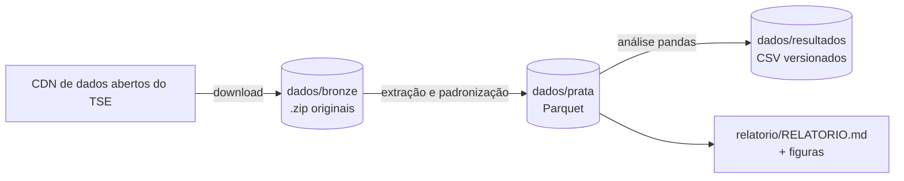

# Eleições gerais no Brasil — dados abertos do TSE

Análise em Python das eleições gerais de **2018 e 2022** (outros anos por parâmetro) a partir dos arquivos
baixados **diretamente do repositório de dados abertos do TSE** (`cdn.tse.jus.br/estatistica/sead/odsele/`).

[](https://github.com/Jefferson019/portfolio/actions/workflows/eleicoes-testes.yml)
[](https://github.com/Jefferson019/portfolio/actions/workflows/eleicoes-atualizar.yml)

**➡️ Relatório com os resultados: [relatorio/RELATORIO.md](relatorio/RELATORIO.md)**
**➡️ Tabelas para conferir: [dados/resultados/](dados/resultados/)**

## O que é analisado

1. **Resultado para presidente** por turno, no Brasil, por região, UF e município — com **conferência
   automática** dos totais calculados contra os números oficiais divulgados pelo TSE.
2. **Geografia do voto**: em quais UFs cada finalista venceu, disputas mais apertadas, quão folgada foi a
   vitória em cada município.
3. **Dinâmica**: quem cresceu do 1º para o 2º turno em cada município e como o voto do mesmo partido mudou
   entre 2018 e 2022, município a município.
4. **Participação**: aptos, comparecimento, abstenção, brancos e nulos por UF e município.
5. **Quem se candidata × quem se elege**: participação de mulheres e de pessoas negras, idade e escolaridade,
   entre candidaturas aptas e eleitos, por cargo.

## Dados do TSE usados

| Conjunto | Arquivo (por ano) | Uso |
|---|---|---|
| Votação nominal por município e zona | `votacao_candidato_munzona/votacao_candidato_munzona_<ano>.zip` | votos de presidente |
| Detalhe da apuração por município e zona | `detalhe_votacao_munzona/detalhe_votacao_munzona_<ano>.zip` | aptos, abstenção, brancos, nulos |
| Candidatos | `consulta_cand/consulta_cand_<ano>.zip` | perfil das candidaturas e eleitos |

## Onde ficam os dados



- **`dados/resultados/` e `relatorio/`** — versionados neste repositório; dá para abrir no próprio GitHub.
  `dados/resultados/fontes_e_execucao.json` registra a URL, o tamanho e o SHA-256 de cada arquivo baixado.
- **`dados/bronze/` (zips originais do TSE) e `dados/prata/`** — grandes demais para o Git; ficam disponíveis
  para download por 90 dias como *artifact* `dados-tse-<id>` em cada execução do workflow
  [Eleições TSE — baixar dados e analisar](../../.github/workflows/eleicoes-atualizar.yml)
  (aba **Actions** → execução → **Artifacts**).

## Como rodar

**No GitHub (sem instalar nada):** aba *Actions* → *Eleições TSE — baixar dados e analisar* → *Run workflow*
(é possível escolher os anos, ex.: `2014 2018 2022`). O workflow também roda sozinho quando o código muda.

**Localmente:**

```bash
cd datascience/prj_eleicoes_tse
pip install -e ".[dev,parquet]"
python -m eleicoes_tse                     # 2018 e 2022
python -m eleicoes_tse --anos 2014 2018 2022
pytest -q                                  # testes com um espelho sintético do TSE (sem internet)
```

O download usa cache: arquivos já presentes em `dados/bronze/` não são baixados de novo.

## Cuidados metodológicos

- Os arquivos do TSE vêm com um CSV por UF e, em alguns anos, um arquivo `_BR`/`_BRASIL` que repete parte dos
  dados. Todos são lidos e as linhas repetidas são removidas pela chave natural (eleição, turno, município, zona,
  cargo, candidato); a conferência com o resultado oficial garante que nada foi contado em dobro.
- Nomes de colunas que mudam entre anos (ex.: `QT_VOTOS_NOMINAIS_VALIDOS` só existe a partir de 2022) são
  resolvidos por uma lista de nomes aceitos por campo (`src/eleicoes_tse/leitura.py`).
- Percentuais de votos sobre **válidos** (como na divulgação oficial); brancos e nulos sobre o comparecimento;
  abstenção sobre os aptos.
- Candidaturas: só as aptas; cada candidatura conta uma vez (situação do último turno disputado);
  % de pessoas negras calculado sobre quem declarou cor/raça.

## Estrutura

```
src/eleicoes_tse/
  config.py      URLs do TSE, anos, regiões, pastas
  fontes.py      download com cache e novas tentativas
  leitura.py     leitura dos CSVs dentro dos .zip e padronização das colunas
  analise.py     indicadores (resultado, participação, entre turnos, comparação entre anos, perfil)
  graficos.py    gráficos do relatório (matplotlib)
  relatorio.py   gera relatorio/RELATORIO.md
  pipeline.py    orquestra tudo
tests/           espelho HTTP sintético no formato do TSE + testes do pipeline completo
```
