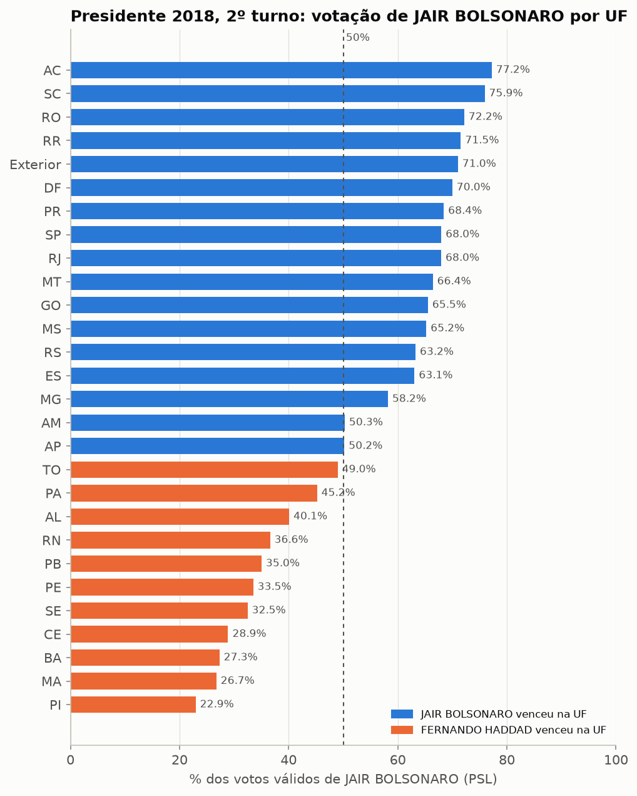
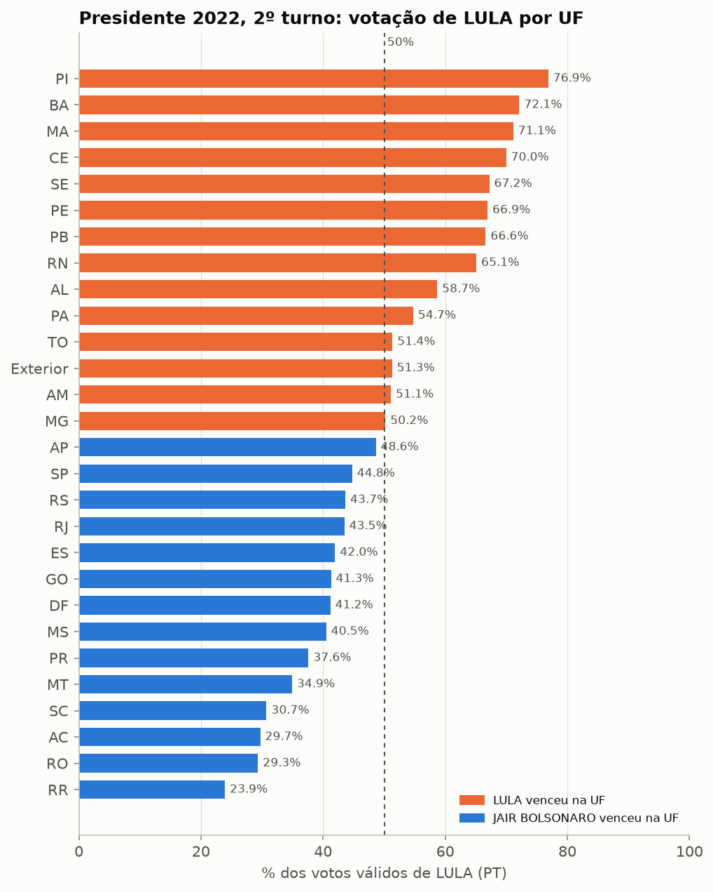
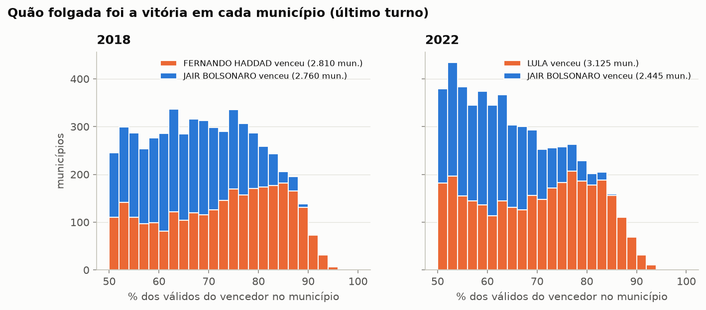
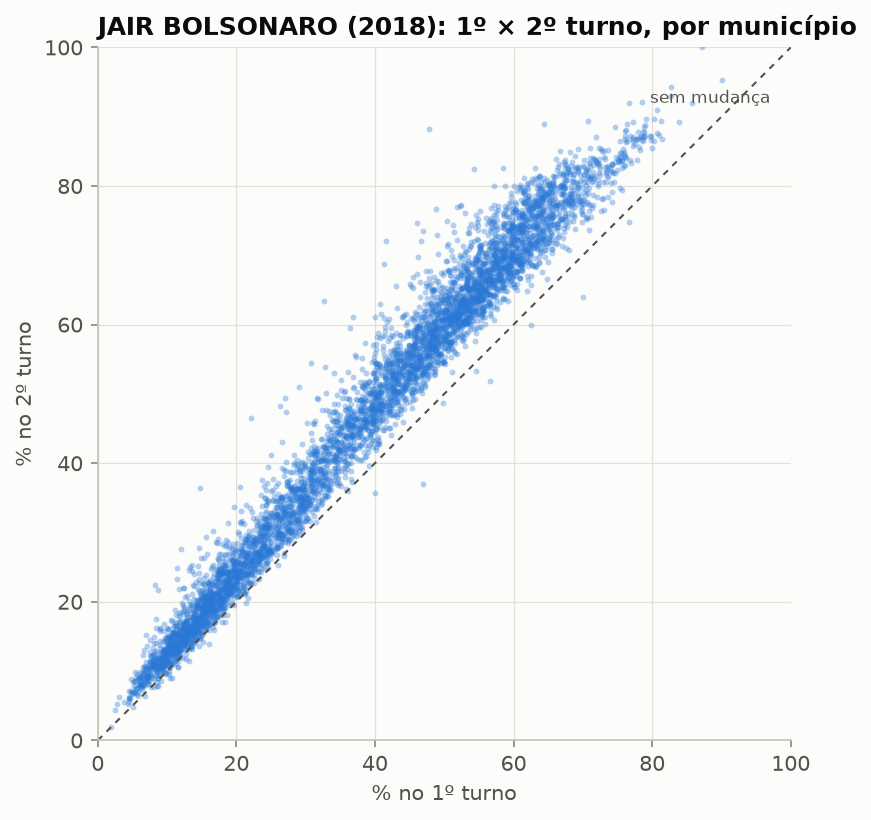
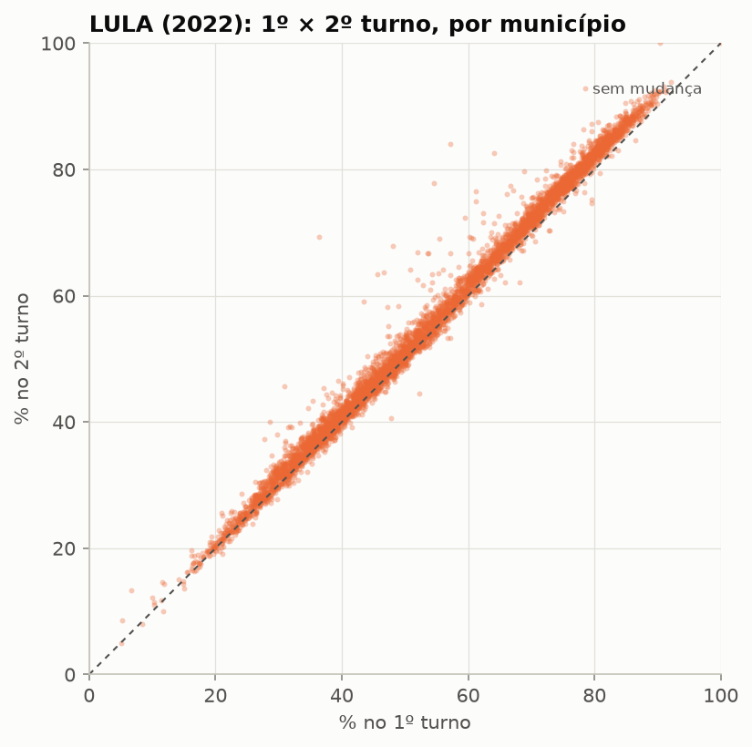
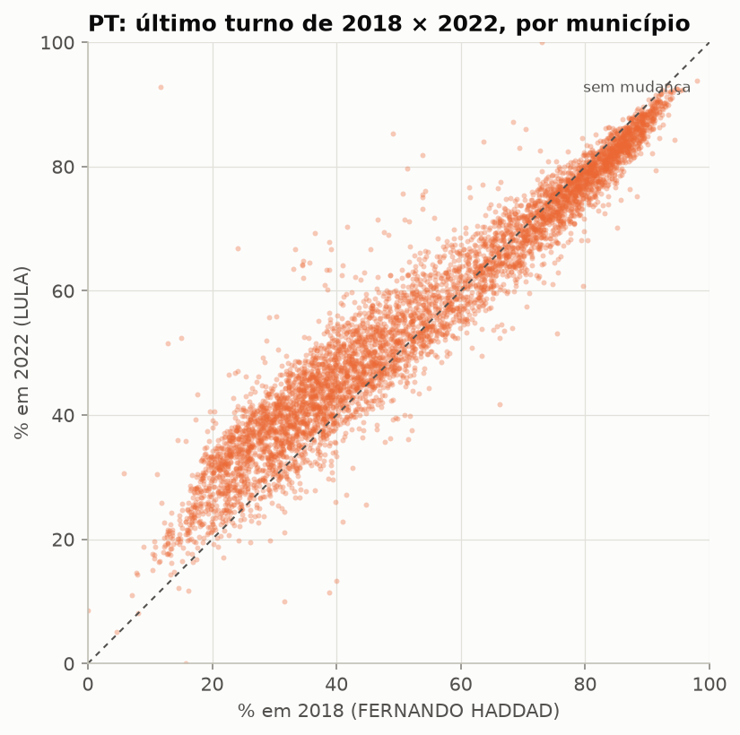
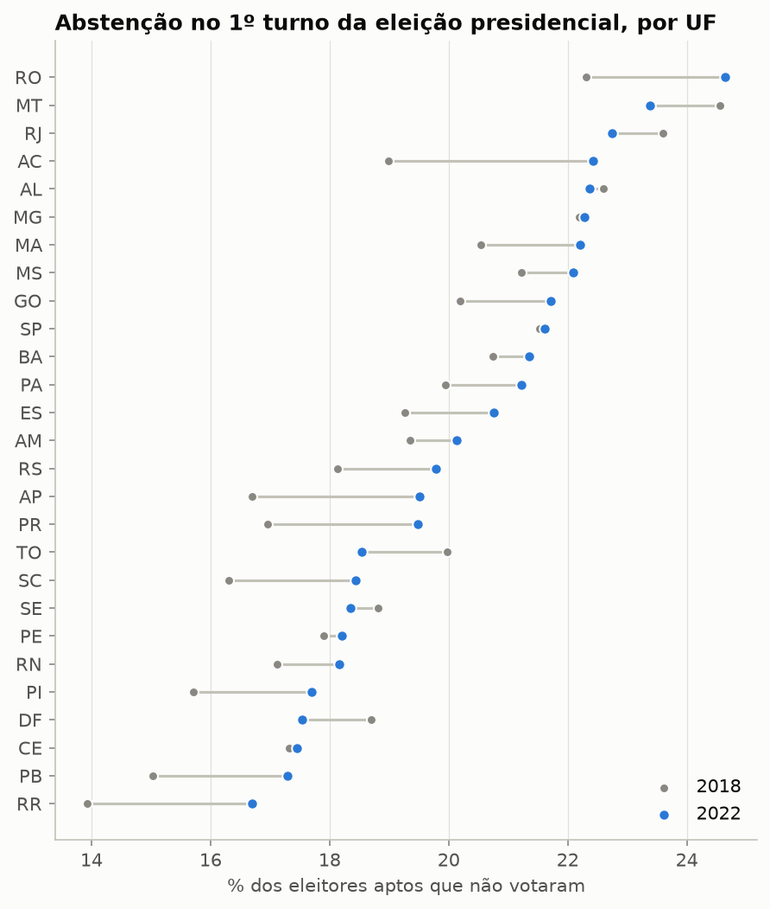
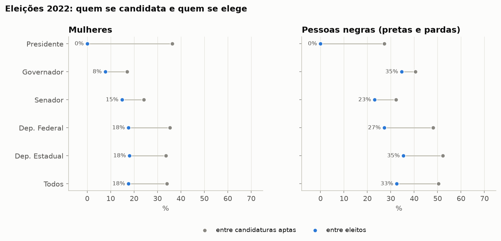

# Eleições gerais no Brasil — análise com os dados abertos do TSE

Relatório gerado automaticamente em **2026-10-31 03:32 UTC** por `python -m eleicoes_tse` a partir dos arquivos baixados do repositório de dados abertos do TSE ([cdn.tse.jus.br/estatistica/sead/odsele](https://dadosabertos.tse.jus.br/)). Anos analisados: **2018, 2022**. As tabelas usadas em cada número estão em [`dados/resultados/`](../dados/resultados/).

## 1. Resultado nacional para presidente

**2018 — 1º turno**

| # | Candidato | Partido | Votos | % válidos |
|---|---|---|---|---|
| 1 | JAIR BOLSONARO | PSL | 49.277.010 | 46,03% |
| 2 | FERNANDO HADDAD | PT | 31.342.051 | 29,28% |
| 3 | CIRO GOMES | PDT | 13.344.371 | 12,47% |
| 4 | GERALDO ALCKMIN | PSDB | 5.096.350 | 4,76% |
| 5 | JOÃO AMOÊDO | NOVO | 2.679.745 | 2,50% |
| 6 | CABO DACIOLO | PATRI | 1.348.323 | 1,26% |

**2018 — 2º turno**

| # | Candidato | Partido | Votos | % válidos |
|---|---|---|---|---|
| 1 | JAIR BOLSONARO | PSL | 57.797.847 | 55,13% |
| 2 | FERNANDO HADDAD | PT | 47.040.906 | 44,87% |

**2022 — 1º turno**

| # | Candidato | Partido | Votos | % válidos |
|---|---|---|---|---|
| 1 | LULA | PT | 57.259.504 | 48,43% |
| 2 | JAIR BOLSONARO | PL | 51.072.345 | 43,20% |
| 3 | SIMONE TEBET | MDB | 4.915.423 | 4,16% |
| 4 | CIRO GOMES | PDT | 3.599.287 | 3,04% |
| 5 | SORAYA THRONICKE | UNIÃO | 600.955 | 0,51% |
| 6 | FELIPE D AVILA | NOVO | 559.708 | 0,47% |

**2022 — 2º turno**

| # | Candidato | Partido | Votos | % válidos |
|---|---|---|---|---|
| 1 | LULA | PT | 60.345.999 | 50,90% |
| 2 | JAIR BOLSONARO | PL | 58.206.354 | 49,10% |

### Conferência com o resultado oficial

Os totais acima foram somados a partir dos arquivos por município e zona e comparados com os números oficiais divulgados pelo TSE: **11 de 11 conferem** (tolerância de 0,01%). Detalhe em [`conferencia_tse.csv`](../dados/resultados/conferencia_tse.csv).

| Ano | Turno | Candidato | Oficial | Calculado |  |
|---|---|---|---|---|---|
| 2018 | 1º | JAIR BOLSONARO | 49.277.010 | 49.277.010 | ✅ |
| 2018 | 1º | FERNANDO HADDAD | 31.342.051 | 31.342.051 | ✅ |
| 2018 | 1º | CIRO GOMES | 13.344.371 | 13.344.371 | ✅ |
| 2018 | 2º | JAIR BOLSONARO | 57.797.847 | 57.797.847 | ✅ |
| 2018 | 2º | FERNANDO HADDAD | 47.040.906 | 47.040.906 | ✅ |
| 2022 | 1º | LULA | 57.259.504 | 57.259.504 | ✅ |
| 2022 | 1º | JAIR BOLSONARO | 51.072.345 | 51.072.345 | ✅ |
| 2022 | 1º | SIMONE TEBET | 4.915.423 | 4.915.423 | ✅ |
| 2022 | 1º | CIRO GOMES | 3.599.287 | 3.599.287 | ✅ |
| 2022 | 2º | LULA | 60.345.999 | 60.345.999 | ✅ |
| 2022 | 2º | JAIR BOLSONARO | 58.206.354 | 58.206.354 | ✅ |

## 2. Geografia do voto

**2018, 2º turno — % dos válidos por região**

| Região | JAIR BOLSONARO | FERNANDO HADDAD |
|---|---|---|
| Centro-Oeste | 66,5% | 33,5% |
| Exterior | 71,0% | 29,0% |
| Nordeste | 30,3% | 69,7% |
| Norte | 51,9% | 48,1% |
| Sudeste | 65,4% | 34,6% |
| Sul | 68,3% | 31,7% |

**2022, 2º turno — % dos válidos por região**

| Região | LULA | JAIR BOLSONARO |
|---|---|---|
| Centro-Oeste | 39,8% | 60,2% |
| Exterior | 51,3% | 48,7% |
| Nordeste | 69,3% | 30,7% |
| Norte | 49,0% | 51,0% |
| Sudeste | 45,7% | 54,3% |
| Sul | 38,2% | 61,8% |

| Ano | UFs vencidas no último turno (27) | Disputa mais apertada |
|---|---|---|
| 2018 | JAIR BOLSONARO: 16 UFs; FERNANDO HADDAD: 11 UFs | AP (JAIR BOLSONARO, margem de 0,4 p.p.) |
| 2022 | JAIR BOLSONARO: 14 UFs; LULA: 13 UFs | MG (LULA, margem de 0,4 p.p.) |

## 3. Municípios

| Ano | Vencedor no município | Municípios | % deles com ≥ 70% dos válidos | % mediano do vencedor |
|---|---|---|---|---|
| 2018 | FERNANDO HADDAD | 2.810 | 60,9% | 74,5% |
| 2018 | JAIR BOLSONARO | 2.760 | 34,9% | 65,7% |
| 2022 | JAIR BOLSONARO | 2.445 | 16,7% | 61,0% |
| 2022 | LULA | 3.125 | 52,4% | 71,2% |

### Do 1º para o 2º turno

Cada ponto é um município. Pontos acima da diagonal são lugares onde o candidato cresceu entre os turnos. A tabela mostra o crescimento mediano de cada finalista e em quantos municípios ele cresceu.

| Ano | Finalista | Ganho mediano 1º→2º | % dos municípios em que cresceu |
|---|---|---|---|
| 2018 | FERNANDO HADDAD | +10,9 p,p, | 99,9% |
| 2018 | JAIR BOLSONARO | +7,7 p,p, | 99,1% |
| 2022 | JAIR BOLSONARO | +4,8 p,p, | 99,7% |
| 2022 | LULA | +1,6 p,p, | 88,6% |

### 2018 × 2022

Partidos que estiveram no último turno nos dois anos, comparados município a município (arquivo [`comparacao_2018_2022_municipio.csv.gz`](../dados/resultados/comparacao_2018_2022_municipio.csv.gz)).

- **PT** (FERNANDO HADDAD em 2018 → LULA em 2022): variação mediana de +1,7 p,p, por município; cresceu em 59,9% dos municípios; passou a vencer em 414 e deixou de vencer em 54.

| Maiores mudanças | UF | 2018 | 2022 | Variação |
|---|---|---|---|---|
| Lusaca | ZZ | 11,8% | 92,9% | +81,1 p,p, |
| Xangai | ZZ | 24,1% | 66,8% | +42,7 p,p, |
| Port Of Spain | ZZ | 12,9% | 51,6% | +38,7 p,p, |
| Kingston-Jamaica | ZZ | 15,0% | 52,4% | +37,4 p,p, |
| Budapeste | ZZ | 49,1% | 85,3% | +36,2 p,p, |

## 4. Comparecimento, abstenção, brancos e nulos

| Ano | Turno | Aptos | Compareceram | Abstenção | Brancos* | Nulos* |
|---|---|---|---|---|---|---|
| 2018 | 1º | 147.306.295 | 117.364.654 | 20,3% | 2,6% | 6,1% |
| 2018 | 2º | 147.306.294 | 115.933.451 | 21,3% | 2,1% | 7,4% |
| 2022 | 1º | 156.454.011 | 123.682.372 | 20,9% | 1,6% | 2,8% |
| 2022 | 2º | 156.454.011 | 124.252.796 | 20,6% | 1,4% | 3,2% |

\* em % dos votos registrados (comparecimento).

Em 2022, no 1º turno, a menor abstenção foi em **RR** (16,7%) e a maior em **RO** (24,6%). O exterior fica de fora do gráfico porque a abstenção lá é estruturalmente muito maior.

## 5. Quem se candidata e quem se elege

Todas as candidaturas aptas a presidente, governador, senador e deputados federais, estaduais e distritais (distritais somados aos estaduais). Cor/raça é autodeclarada no registro da candidatura; o percentual de pessoas negras (pretas + pardas) é calculado sobre quem informou.

| Ano | Cargo | Candidaturas | Eleitos | Mulheres (cand.) | Mulheres (eleitas) | Negros (cand.) | Negros (eleitos) | Idade mediana eleitos |
|---|---|---|---|---|---|---|---|---|
| 2018 | Presidente | 13 | 1 | 15,4% | 0,0% | 23,1% | 0,0% | – |
| 2018 | Governador | 184 | 27 | 15,2% | 3,7% | 32,1% | 25,9% | – |
| 2018 | Senador | 324 | 54 | 17,6% | 11,1% | 32,2% | 25,9% | – |
| 2018 | Deputado Federal | 7.641 | 512 | 31,7% | 15,0% | 40,8% | 23,8% | – |
| 2018 | Deputado Estadual | 16.973 | 1.058 | 31,2% | 15,3% | 49,0% | 28,8% | – |
| 2018 | Todos | 25.135 | 1.652 | 31,0% | 14,9% | 46,2% | 27,1% | – |
| 2022 | Presidente | 11 | 1 | 36,4% | 0,0% | 27,3% | 0,0% | – |
| 2022 | Governador | 205 | 26 | 17,1% | 7,7% | 40,5% | 34,6% | – |
| 2022 | Senador | 207 | 27 | 24,2% | 14,8% | 32,2% | 23,1% | – |
| 2022 | Deputado Federal | 9.476 | 512 | 35,3% | 17,6% | 48,1% | 27,2% | – |
| 2022 | Deputado Estadual | 15.828 | 1.059 | 33,6% | 18,0% | 52,2% | 35,3% | – |
| 2022 | Todos | 25.727 | 1.625 | 34,0% | 17,7% | 50,4% | 32,6% | – |

**Escolaridade (2022)** — taxa de sucesso = eleitos ÷ candidaturas aptas.

| Grau de instrução | Candidaturas | Eleitos | % dos eleitos | Taxa de sucesso |
|---|---|---|---|---|
| Superior Completo | 14.222 | 1.293 | 79,6% | 9,1% |
| Superior Incompleto | 2.413 | 126 | 7,8% | 5,2% |
| Ensino Médio Completo | 6.459 | 166 | 10,2% | 2,6% |
| Ensino Fundamental Completo | 1.163 | 22 | 1,4% | 1,9% |
| Ensino Fundamental Incompleto | 638 | 9 | 0,6% | 1,4% |
| Ensino Médio Incompleto | 639 | 8 | 0,5% | 1,3% |
| Lê E Escreve | 188 | 1 | 0,1% | 0,5% |
| Não Divulgável | 5 | 0 | 0,0% | 0,0% |

## Fontes e reprodutibilidade

Arquivos originais baixados nesta execução (o SHA-256 permite conferir que são os mesmos do TSE). Os .zip completos ficam disponíveis para download como *artifact* da execução do workflow no GitHub Actions.

| Ano | Conjunto | Arquivo | Tamanho | SHA-256 |
|---|---|---|---|---|
| 2018 | votacao_candidato_munzona | [votacao_candidato_munzona_2018.zip](https://cdn.tse.jus.br/estatistica/sead/odsele/votacao_candidato_munzona/votacao_candidato_munzona_2018.zip) | 395.4 MB | `f880848ef4ba340b…` |
| 2018 | detalhe_votacao_munzona | [detalhe_votacao_munzona_2018.zip](https://cdn.tse.jus.br/estatistica/sead/odsele/detalhe_votacao_munzona/detalhe_votacao_munzona_2018.zip) | 4.3 MB | `df68c258a2261dff…` |
| 2018 | consulta_cand | [consulta_cand_2018.zip](https://cdn.tse.jus.br/estatistica/sead/odsele/consulta_cand/consulta_cand_2018.zip) | 4.7 MB | `57f6881f1aa03614…` |
| 2022 | votacao_candidato_munzona | [votacao_candidato_munzona_2022.zip](https://cdn.tse.jus.br/estatistica/sead/odsele/votacao_candidato_munzona/votacao_candidato_munzona_2022.zip) | 567.9 MB | `f01ac506fbd33e95…` |
| 2022 | detalhe_votacao_munzona | [detalhe_votacao_munzona_2022.zip](https://cdn.tse.jus.br/estatistica/sead/odsele/detalhe_votacao_munzona/detalhe_votacao_munzona_2022.zip) | 4.4 MB | `ae8bf91a62eb00dc…` |
| 2022 | consulta_cand | [consulta_cand_2022.zip](https://cdn.tse.jus.br/estatistica/sead/odsele/consulta_cand/consulta_cand_2022.zip) | 4.4 MB | `d8fda23be824e312…` |

Observações metodológicas: votos de presidente somados por município a partir dos arquivos por município e zona (`votacao_candidato_munzona`); percentuais sobre votos válidos (exclui brancos e nulos), como na divulgação oficial; o código de município é o do TSE (não o do IBGE); `ZZ` = votos no exterior.
