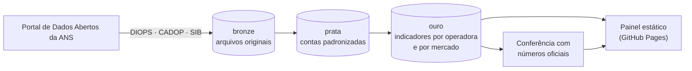

# Observatório da Saúde Suplementar

**Sinistralidade e indicadores econômico-financeiros de todas as operadoras de planos de saúde do Brasil, calculados direto dos dados abertos da ANS — com conferência automática contra os números oficiais.**

[](https://github.com/Jefferson019/portfolio/actions/workflows/observatorio-testes.yml)
[](https://github.com/Jefferson019/portfolio/actions/workflows/observatorio-atualizar.yml)


**➡️ Painel: https://jefferson019.github.io/portfolio/observatorio-saude-suplementar/**

<!-- Depois da primeira publicação, salve uma captura do painel em docs/img/painel.png e descomente a linha abaixo -->
<!--  -->

---

## Por que este projeto existe

A ANS publica praticamente tudo sobre o mercado de planos de saúde — mas em arquivos brutos: balancetes
contábeis trimestrais de cada operadora (milhões de linhas), um plano de contas que muda de tempos em tempos,
convenções de sinal não documentadas e cadastros separados. Quem quer responder perguntas simples, como
*"qual a sinistralidade das cooperativas médicas nos últimos 12 meses?"* ou *"onde a minha operadora está em
relação às pares?"*, acaba refazendo o mesmo trabalho manual a cada trimestre.

Este projeto transforma esses arquivos em **indicadores prontos, auditáveis e atualizados automaticamente**,
por operadora e por mercado.

## O que você encontra aqui

| | |
|---|---|
| 📊 **Painel interativo** | Sinistralidade ao longo do tempo, por modalidade e por porte; para onde vão R$ 100 de mensalidade; resultado operacional × financeiro; concentração de mercado; beneficiários; tabela de todas as operadoras com detalhe individual. Abre no navegador, sem instalar nada. |
| 🗂️ **Base tratada** | Uma tabela por operadora × trimestre × janela de tempo (CSV e Parquet), pronta para análise em Python, R, Power BI ou Excel. |
| ✅ **Conferência com a ANS** | 69 números oficiais divulgados pela ANS (lucro do setor, sinistralidade, receitas, aplicações financeiras…) recalculados a partir dos dados brutos, com o resultado de cada comparação. |
| 🔄 **Atualização automática** | Um workflow do GitHub Actions baixa os dados novos todo mês, recalcula tudo e republica o painel. |

## Indicadores

| Indicador | Definição resumida |
|---|---|
| Sinistralidade | Eventos indenizáveis líquidos ÷ contraprestações (receita de mensalidades) |
| Despesa administrativa e de comercialização | Cada uma ÷ contraprestações |
| Índice combinado | (Assistencial + administrativa + comercialização) ÷ contraprestações |
| Resultado operacional, financeiro, patrimonial e líquido | Pela estrutura da DRE do Plano de Contas Padrão da ANS |
| Margem operacional e margem líquida | Resultado ÷ receita |
| Liquidez corrente e geral, endividamento, ROE | A partir do balanço trimestral |
| Prazo médio de recebimento de contraprestações | Créditos de operações com planos ÷ receita × 360 |
| Aplicações financeiras e provisões técnicas | Saldos de fim de trimestre |
| Beneficiários, porte e mensalidade média | A partir do SIB (beneficiários por operadora) |
| Concentração (HHI, participação das 5 e 10 maiores) | Por receita e por beneficiários |
| Distribuição entre operadoras | Mediana, 1º e 3º quartis da sinistralidade; % de operadoras com lucro e com prejuízo operacional |

Todos em três janelas: **acumulado no ano** (como a ANS divulga), **trimestre isolado** e **últimos 12 meses**
(sem sazonalidade). Fórmulas completas em [docs/indicadores.md](docs/indicadores.md).

## Como funciona



### Decisões técnicas que fazem diferença

- **Plano de contas resolvido pela descrição, não por código fixo.** O plano mudou (RN 290 → RN 435 → RN 528):
  "Receitas Financeiras", por exemplo, já foi o grupo 34 e hoje é o 35. Cada trimestre é mapeado pela descrição
  das contas que vem no próprio arquivo, e o resultado fica registrado para auditoria.
- **Sinal dos saldos inferido e validado.** A convenção de sinal (credor positivo ou negativo, deduções em valor
  absoluto ou não) é detectada trimestre a trimestre e conferida contra os totais de classe do balancete.
- **Acumulação detectada, não suposta.** O pipeline confirma que os saldos de resultado são acumulados no ano
  (saldo inicial do trimestre = saldo final do anterior) antes de calcular trimestres isolados e 12 meses.
- **Razões de mercado ponderadas**, como faz a ANS: soma das despesas ÷ soma das receitas, nunca média simples.
- **A definição de sinistralidade é escolhida por evidência**: o pipeline calcula as duas variantes possíveis
  (sobre contraprestações brutas ou líquidas de tributos) e adota a que reproduz os números oficiais.
- **Testado contra um "espelho" sintético do portal da ANS** que reproduz as armadilhas reais (dois layouts de plano
  de contas, latin-1 e UTF-8, duas convenções de sinal, linhas duplicadas, trimestre faltante, operadora fora do
  cadastro). O teste exige que o pipeline reproduza o gabarito ao centavo.

## Rodando na sua máquina

Requer Python 3.11 ou superior.

```bash
git clone https://github.com/Jefferson019/portfolio.git
cd portfolio/datascience/prj_observatorio_saude_suplementar
python -m venv .venv
source .venv/bin/activate            # Windows: .venv\Scripts\activate
pip install -e ".[parquet]"

python -m observatorio_ans           # pipeline completo
python -m http.server 8000 --directory site   # painel em http://localhost:8000
```

| Comando | O que faz |
|---|---|
| `python -m observatorio_ans` | Baixa, processa e gera o painel. Na primeira vez baixa ~300 MB de demonstrações contábeis e ~400 MB por mês de beneficiários processado; depois, só o que mudou. |
| `python -m observatorio_ans --sem-beneficiarios` | Versão rápida, só com os dados contábeis. |
| `python -m observatorio_ans --sem-download` | Modo offline: usa os arquivos já presentes em `dados/bronze/`. |
| `python -m observatorio_ans painel` | Só regera o painel a partir de `dados/ouro/`. |
| `python -m observatorio_ans --ano-inicio 2021` | Período menor (a série de 12 meses começa um ano depois). |

As tabelas finais ficam em `dados/ouro/` e o relatório de qualidade de cada execução em
`dados/ouro/relatorio_qualidade.json` (encoding, convenção de sinal, mapeamento de contas e conferência de cada trimestre).

Exemplo de análise com a base pronta:

```python
import pandas as pd

ops = pd.read_csv("dados/ouro/operadoras_indicadores.csv.gz", dtype={"reg_ans": str})
ultimo = ops.query("periodo == periodo.max() and janela == '12_meses' and amostra_valida")
(
    ultimo.groupby("modalidade")
    .apply(lambda g: g.despesa_assistencial.sum() / g.receita_contraprestacoes.sum())
    .sort_values()
)
```

## Publicando o painel

O projeto fica nesta pasta do repositório `portfolio`; os workflows do GitHub Actions ficam na raiz do repositório
(`.github/workflows/observatorio-testes.yml` e `observatorio-atualizar.yml`), porque o GitHub só executa workflows de
lá. O passo a passo (ligar o GitHub Pages, disparar a primeira atualização e copiar o projeto para um repositório
próprio) está em [docs/como-publicar.md](docs/como-publicar.md).

## Estrutura

```
├── src/observatorio_ans/
│   ├── fontes.py          # acesso ao portal da ANS (listagem e download com cache)
│   ├── contabil.py        # DIOPS: leitura, sinais, acumulação e janelas de tempo
│   ├── plano_contas.py    # mapeamento contas → conceitos, resolvido pela descrição
│   ├── cadastro.py        # CADOP: operadoras ativas e canceladas, modalidade e segmento
│   ├── beneficiarios.py   # SIB: beneficiários por operadora, contratação, UF e porte
│   ├── indicadores.py     # indicadores por operadora
│   ├── mercado.py         # agregados de mercado, distribuição e concentração
│   ├── conciliacao.py     # conferência com números oficiais divulgados pela ANS
│   ├── painel.py          # gera o site estático
│   ├── referencias/       # números oficiais usados na conferência (com fonte e link)
│   └── templates/         # HTML do painel (sem dependências externas)
├── tests/                 # testes ponta a ponta contra um espelho sintético do portal
├── docs/                  # metodologia, dicionário de indicadores, publicação
├── dados/historico/       # agregados pequenos de beneficiários, versionados mês a mês
└── projeto.toml           # seus dados de autor e parâmetros do pipeline
```

Os workflows de testes e de atualização mensal ficam na raiz do repositório, em `.github/workflows/observatorio-*.yml`.

## Limitações

- Os números são os informados pelas operadoras à ANS e podem ser reenviados ou corrigidos depois; a cada
  execução o pipeline reprocessa o que mudou no portal.
- A ANS aplica critérios próprios de consistência no seu painel. Diferenças pequenas em relação aos números oficiais
  são esperadas e ficam visíveis na conferência.
- Este é um projeto independente, sem vínculo com a ANS. Ele não substitui as publicações oficiais.

Detalhes em [docs/metodologia.md](docs/metodologia.md).

## Autor

**Jefferson Marques da Silva** — cientista de dados com mais de uma década de experiência em operadora de planos
de saúde (contas médicas, controladoria, auditoria interna e ciência de dados). Databricks Certified Machine
Learning Professional. Dados e IA para operadoras de planos de saúde.

[LinkedIn](https://www.linkedin.com/in/jefferson-marques-da-silva-431606165) · [GitHub](https://github.com/Jefferson019)

## Licença

Código sob licença [MIT](LICENSE). Os dados são da Agência Nacional de Saúde Suplementar (ANS), disponíveis no
[Portal de Dados Abertos](https://dadosabertos.ans.gov.br/FTP/PDA/), e podem ser reutilizados citando a fonte.
